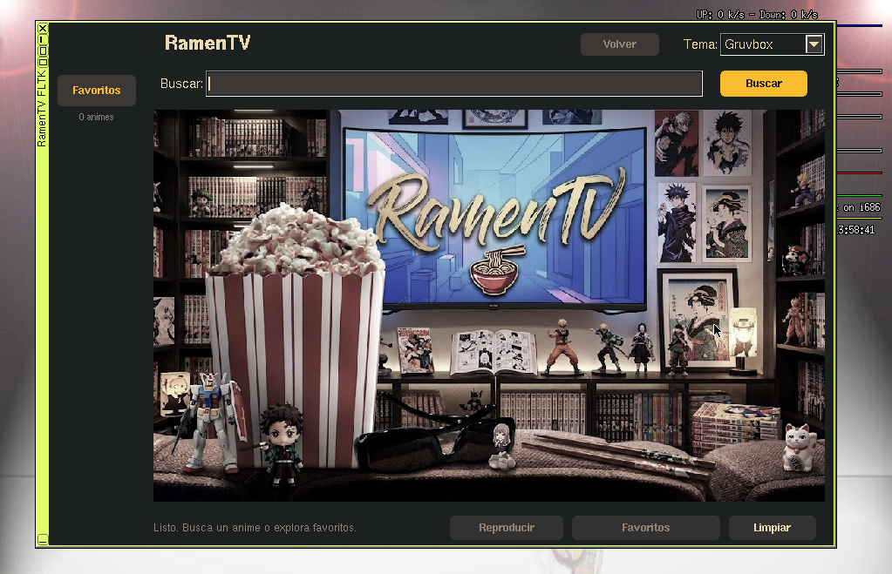
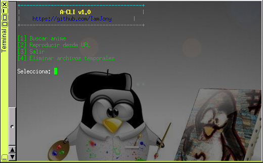

# ramentv

 [](https://github.com/IamJony/A-CLI) 


**Ramentv** es una interfaz gráfica (GUI) desarrollada en **FLTK** para **FLINUX** y **Tiny Core Linux**. Funciona como un *wrapper* (envoltorio) visual del proyecto A-CLI potente script en Bash diseñado para buscar y reproducir anime subtitulado al español directamente desde la terminal.




## Características

- **GUI en FLTK** con grilla de carátulas, temas personalizables, gestión de favoritos y buscador integrado.
- **CLI en bash** (A-CLI) para usar directamente desde la terminal. Puedes lanzarlo con el comando `ramentv-cli-launcher`.
- **Reproducción fluida:** Utiliza `mplayer` o `mpv` en conjunto con `yt-dlp` para extraer y reproducir los streams de video.

## Dependencias

### Para compilar (Entorno de desarrollo)
- `compiletc` (g++, make)
- `fltk-1.3-dev`
- `libX11-dev`
- `libXft-dev`
- `squashfs-tools` (si deseas empaquetar la aplicación)

### Para ejecutar (Entorno de usuario)
- `fltk-1.3`
- `mplayer` (o `mpv` como alternativa)
- `curl` (para peticiones HTTP)
- `jq` (para procesar JSON)
- `bash`
- `yt-dlp` (para poder reproducir con mplayer los enlaces de video)
- `python3` (requerido por `yt-dlp`)
- `ffmpeg` (opcional, pero mejora la extracción y estabilidad con `yt-dlp`)

## Instalación y Uso

1. **Clona el repositorio:**
   ```bash
   git clone https://github.com/IamJony/RamenTV.git
   cd RamenTV
